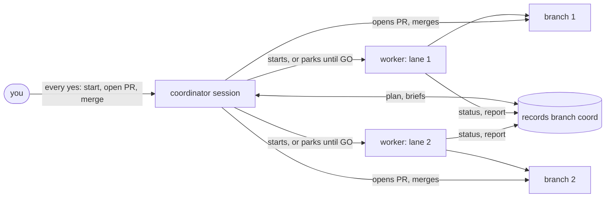

# relay

Run several Claude Code sessions on one repo at the same time, with your consent gated in one place.

Built to sit beside [mattpocock-skills](https://github.com/mattpocock/skills): they turn an idea into issues, relay gets those issues built in parallel.

## The problem

Once the work is split into issues, building them in parallel by hand means opening a session per issue, briefing each one, remembering which is waiting on which, and answering questions in a dozen windows. Nothing records who is done, and nothing stops a session from opening a PR or merging before you said so.

relay makes one desktop-app session the **coordinator**. It orders the issues, starts one **worker** session per lane, an issue or a few small ones (parking the lanes that must wait), and asks you every question that needs your consent: start these lanes, open this PR, merge it. Workers branch, test, review and report; the coordinator opens the PRs. A records branch keeps the plan, so another day, machine or coordinator can pick up where this one stopped.

## How it works



The records branch is an orphan branch, `coord`, checked out beside the repo as the records folder `<repo>-coord/` and never merged:

```
project.md      settings: language, checks, test bar, off-limits paths
plan.md         current state only (done work moves to plan-history.md)
briefs/<key>.md ~10-line briefs, one per lane
status/<key>.md written by relay.py status
reports/  pr-bodies/
```

## Compared with the alternatives

| | Sessions by hand | `/implement-spec` | relay |
|---|---|---|---|
| Unit of work | a session you start and brief | a subagent, gone when it finishes | a desktop-app session per lane, with its own worktree and branch, that you can open and talk to |
| Output | whatever each session does | one integration branch, at most one PR at the end | one PR per lane |
| Your yes | in each window, if asked | once, to start the run | before each session, PR and merge, all in the coordinator |
| Review | whatever you ask for | once, over the whole integration branch | per lane, scoped to its issues and brief |
| State | in your head | none; an interrupted run starts over | the plan, `status/` and `reports/` on the `coord` branch |

Pick `/implement-spec` for a few tickets you want done fast with one final review. Pick relay when each change should be reviewed and merged on its own, or the work spans days or machines. More in [Getting started](docs/getting-started.md#relay-or-implement-spec).

## Lightweight, in numbers

- **No server.** Three skills, two Python scripts (standard library only) and one `SessionStart` hook. Everything else is git, `gh` and the desktop app.
- **One branch.** All records live on `coord` (a public repo may keep them in a separate private repo instead). On your default branch, relay adds only what you accept during setup: a pointer line in `AGENTS.md` (required only with a separate records repo), a paragraph in `docs/agents/issue-tracker.md`, and a CI workflow if the repo has none.
- **One line always loaded.** Only `relay:work` is model-invoked, so its one-line description is the cost in every session. `/relay:setup` and `/relay:coordinate` load only when you type them.
- **A small main skill.** `/relay:coordinate` is 92 lines and 2,579 words (117 lines and 3,857 words before the slimming in [#112](https://github.com/mileschintw/relay/issues/112)), with six sub-files read only when needed.

## Example

A round on this repo, condensed. #145 and #119 both edit README's Install section, so #119 waits for #145:

```
you          /relay:coordinate
coordinator  Ready: #114, #116, #118, #130, #139, #140, #145, #119, #115.
             #119 edits the same README section as #145: start #145 now, park #119
             until it merges. Start this round?
you          開工這一輪   ("start this round")
coordinator  Started the lanes; 119 and 115 parked (119 waits for GO #119).
   ...       workers branch, test, review, write status/<key>.md and a report
coordinator  Lane 145 is done, no blocker. Opened PR #148; merge once CI passes?
you          yes
coordinator  #148 merged. Sent GO #119; lane 119 started from the new main.
```

## Install

Requires: Claude Code desktop app, mattpocock-skills, git 2.38+, `gh` (signed in), Python 3.10+. The project must be a GitHub repo.

```
/plugin marketplace add mileschintw/relay
/plugin install relay@relay
/relay:setup                  # once per project, after /setup-matt-pocock-skills
```

The plugin is cloned over HTTPS, so installs and updates need no GitHub SSH key.

Day to day: `/grill-with-docs` to design, `/to-tickets` for issues with blocking links, then `/relay:coordinate` in a new desktop-app session.

## More

- [Getting started](docs/getting-started.md): the full walkthrough and the rules worth knowing
- [Layout](docs/layout.md): what each file in this repo does
- [Releasing](docs/releasing.md): how a merge to `main` reaches users
- [Decisions](docs/adr/)
