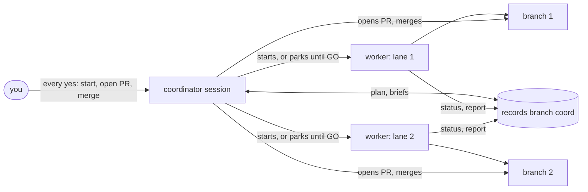

# Lane 119 報告

- **分支與 head:** `claude/lane-119-a8c166`。head 見 `status/119.md`(與 `origin/main` 7c09945 合併後的最新 commit)。
- **issue 中已不成立的項目:** issue 說要改 skills 裡「README Layout in step」的措辭,但 `plugin/` 裡沒有任何 skill 指向 README 的 Layout 或 Releasing(`grep -rni readme plugin/` 沒有結果)。只有 records 的 `project.md` 有指向,所以不需要改 skill。

## 各檔案的變更

- `README.md`:改寫成一頁式產品頁,章節依序是:
  - The problem
  - How it works:Mermaid 圖畫出 coordinator → workers → records branch,PR 由 coordinator 開
  - Compared with the alternatives:比較手動開 session、`/implement-spec` 和 relay,沿用 getting-started 的比較,另加「手動」欄
  - Lightweight, in numbers
  - Example:改成本 repo 這一輪的真實流程(#145 先跑,#119 等它),內容是濃縮過的
  - Install:三行。lane 145 的 HTTPS 句子原樣保留
  - More:連到 docs
  
  Layout 與 Releasing 兩節已從 README 移除。
- `docs/layout.md`(新檔):原 Layout 表格逐列搬來,另外補上 `README.md`、`docs/layout.md`、`docs/releasing.md` 三列。
- `docs/releasing.md`(新檔):原 Releasing 一節逐字搬來。
- `docs/getting-started.md`:
  - 刪掉「The repo is private, so the machine's git must be signed in to GitHub.」(repo 現在是 PUBLIC),換成 lane 145 的 HTTPS 句子。
  - 結尾加上「See also」,連到 README、Layout、Releasing。

## 請 coordinator 修改 records 的 `project.md`

- **Test bar:**「the checks above pass and each new behaviour in `plugin/tools/relay.py` has a test in `tests/test_relay.py`; skill and doc changes keep `docs/layout.md`'s table and `plugin/GLOSSARY.md` in step.」
- **Release:**「`docs/releasing.md`. A release is ready when …」(後面照舊,只把「README.md, section "Releasing"」換成 `docs/releasing.md`)

## 預設分支上原本就失敗的檢查

無。開工時在 `origin/main`(5cbd238)跑過一次:151 個測試 OK,validate 通過。

## 檢查與 lane 測試

在合併後的 head 上執行:

- `py -3 -I tests/test_relay.py`:`Ran 182 tests in 195.859s` `OK`(fa047b4,合併 main 72eec55 之後;之後的 bd964d0 只改 README 和 docs,測試不會讀這些檔案)。
- `claude plugin validate .`:`✔ Validation passed`(bd964d0)。
- **每個連結都能解析:** 用腳本檢查 `README.md`、`docs/*.md` 的每個相對連結與錨點,10 個全 OK,包括 `docs/getting-started.md#relay-or-implement-spec`。外部連結有兩個(mattpocock/skills、issue #112),沒有實際打開檢查。
- **沒有 skill 指向 README:** `grep -rni readme plugin/` 沒有結果(exit 1)。
- **「lightweight」數字在合併後的 main 上量:**
  - `wc -lw plugin/skills/coordinate/SKILL.md` 在 72eec55 上是 96 行、2,899 字;#112 瘦身前(`ab53aeb~1`)是 117 行、3,857 字。
  - 只有 `relay:work` 沒有 `disable-model-invocation`。
  - 兩支腳本只 import 標準函式庫。
- 沒有略過的測試,也沒有只能在 main checkout 跑的檢查。

## 衝突

沒有衝突。完成前 `origin/main` 合入了 #152(lane 116),coordinate `SKILL.md` 從 92 行、2,579 字變成 94 行、2,668 字,README 和 PR body 的數字已跟著更新。`relay.py` 的子命令沒變,Layout 表不用改。

## Review 發現與處理

- **第 1 輪**(standards 與 spec 兩個 sub-agent):
  - 圖上畫成 worker 產出 PR,和 glossary 的「coordinator opens the PR」矛盾。已修正。
  - 比較表和 getting-started 的版本不一致:少了「at most」、少了「desktop-app」、缺 Review 列。已修正。
  - 範例是虛構的,issue 要的是真實範例。已換成本輪的真實流程。
  - 用詞:「per issue」改為「per lane」,並寫出 records folder。已修正。
  - 標語「every yes asked in one place」說得過頭(worker 會直接向使用者提問),改成「consent gated in one place」。
  - 使用獨立 records repo 時,pointer line 是必要的。已補註。
  - getting-started 寫 repo 是 private,實際是 public。已修正。
  - records `project.md` 指向 README。這不在本 lane 範圍內,上面已提供新措辭。
  - 安裝說明在 README 和 getting-started 各有一份。只列為備註,產品頁本來就需要短版。
- **第 2 輪:** 範例寫了一段我沒看到的合併問答(問題和「yes」)。已刪掉,只留確定發生的事:PR #148 開出、CI 過後合併、送出 GO #119。沒有剩下的 blocker。

## 其他

- **新開的 issue:** 無。
- **lane 外、tracker 已有的問題:** 無。
- **repo 與 scratchpad 之外建立的東西:** `$TEMP/lc.py`(連結檢查腳本,暫存檔)。
- **使用者在本 session 的決定:** 無。本 session 沒有直接問過使用者。範例中引用的「開工這一輪」來自 brief 記錄的本輪開工答覆。
- **給 coordinator 的問題:**
  1. 請確認範例的濃縮描述(「Ready: …」清單和 coordinator 的措辭)可以接受。它反映的是本輪的事實,但不是逐字對話。
  2. 請照上面的措辭修改 `project.md` 的 Test bar 與 Release 兩行。

## 最後一輪檢查(GO #119 final pass,main 72eec55)

- 合併 `origin/main`(72eec55),沒有衝突。
- **數字重量:** coordinate `SKILL.md` 96 行、2,899 字。3 個 skill、2 支只用標準函式庫的腳本、1 個 hook、6 個子檔，都核對過。
- **Layout(`docs/layout.md`)對照 `git ls-files`:**
  - 新增 3 列：`plugin/.claude-plugin/plugin.json`、`docs/agents/`、`tests/` 的 `fake_gh.py`。
  - setup 那列補上 `templates/`。
  - `ready` 那列補上 75 秒預算、Skipped 段、deny list 掃描與 PR body 檢查。
  - `waitchecks` 那列補上沒有 check 時會指出 `ci-fallbacks.md` 的哪種情況。
  - `CLAUDE.md`、`.gitattributes`、`.gitignore` 沒有列，因為是 repo 設定檔。
- **getting-started:**
  - 步驟 3:加入本輪的 merge right(同一回合一併詢問)和 spares(含 `CLOSE`)。
  - 步驟 5:有 merge right 時直接開 PR、CI 過後合併;若報告列了沒跑的 check,仍會再問一次。
  - Rules:spares 存在的原因，以及 Main checkout 一次只給一個 lane。
  - 比較表「Your yes」改成「每輪」。
- **README:**
  - 比較表「Your yes」同樣改成「每輪」。
  - records 樹的 `project.md` 補上 alarm、deny list。
- **審查(只看 0091dc9..fa047b4):** 沒有 blocker。四個備註中，已修兩個(merge right 的例外、「same turn」)。另外兩個保留:
  - 範例沒有呈現 merge right 的提問，因為我無法確認本輪的實際措辭，只寫確定發生的事。
  - Lane kinds 只透過 spares 提到，為了讓頁面保持簡短。

## 新的 README 全文

~~~~markdown
# relay

Run several Claude Code sessions on one repo at the same time, with your consent gated in one place.

Built to sit beside [mattpocock-skills](https://github.com/mattpocock/skills): they turn an idea into issues, relay gets those issues built in parallel.

## The problem

Once the work is split into issues, building them in parallel by hand means opening a session per issue, briefing each one, remembering which is waiting on which, and answering questions in a dozen windows. Nothing records who is done, and nothing stops a session from opening a PR or merging before you said so.

relay makes one desktop-app session the **coordinator**. It orders the issues, starts one **worker** session per lane, an issue or a few small ones (parking the lanes that must wait), and asks you every question that needs your consent: start these lanes, open this PR, merge it. Workers branch, test, review and report; the coordinator opens the PRs. A records branch keeps the plan, so another day, machine or coordinator can pick up where this one stopped.

## How it works



The records branch is an orphan branch, `coord`, checked out beside the repo as the records folder `<repo>-coord/` and never merged:

```
project.md      settings: language, checks, test bar, off-limits paths, alarm, deny list
plan.md         current state only (done work moves to plan-history.md)
briefs/<key>.md ~10-line briefs, one per lane
status/<key>.md written by relay.py status
reports/  pr-bodies/
```

## Compared with the alternatives

| | Sessions by hand | `/implement-spec` | relay |
|---|---|---|---|
| Unit of work | a session you start and brief | a subagent, gone when it finishes | a desktop-app session per lane, with its own worktree and branch, that you can open and talk to |
| Output | whatever each session does | one integration branch, at most one PR at the end | one PR per lane |
| Your yes | in each window, if asked | once, to start the run | before each round of sessions, and for its PRs and merges (once for the round, or per lane), all in the coordinator |
| Review | whatever you ask for | once, over the whole integration branch | per lane, scoped to its issues and brief |
| State | in your head | none; an interrupted run starts over | the plan, `status/` and `reports/` on the `coord` branch |

Pick `/implement-spec` for a few tickets you want done fast with one final review. Pick relay when each change should be reviewed and merged on its own, or the work spans days or machines. More in [Getting started](docs/getting-started.md#relay-or-implement-spec).

## Lightweight, in numbers

- **No server.** Three skills, two Python scripts (standard library only) and one `SessionStart` hook. Everything else is git, `gh` and the desktop app.
- **One branch.** All records live on `coord` (a public repo may keep them in a separate private repo instead). On your default branch, relay adds only what you accept during setup: a pointer line in `AGENTS.md` (required only with a separate records repo), a paragraph in `docs/agents/issue-tracker.md`, and a CI workflow if the repo has none.
- **One line always loaded.** Only `relay:work` is model-invoked, so its one-line description is the cost in every session. `/relay:setup` and `/relay:coordinate` load only when you type them.
- **A small main skill.** `/relay:coordinate` is 96 lines and 2,899 words (117 lines and 3,857 words before the slimming in [#112](https://github.com/mileschintw/relay/issues/112)), with six sub-files read only when needed.

## Example

A round on this repo, condensed. #145 and #119 both edit README's Install section, so #119 waits for #145:

```
you          /relay:coordinate
coordinator  Ready: #114, #116, #118, #130, #139, #140, #145, #119, #115.
             #119 edits the same README section as #145: start #145 now, park #119
             until it merges. Start this round?
you          開工這一輪   ("start this round")
coordinator  Started the lanes; 119 and 115 parked (119 waits for GO #119).
   ...       workers branch, test, review, write status/<key>.md and a report
coordinator  Lane 145 is done, no blocker. PR #148 opened and, after CI, merged.
             Sent GO #119; lane 119 started from the new main.
```

## Install

Requires: Claude Code desktop app, mattpocock-skills, git 2.38+, `gh` (signed in), Python 3.10+. The project must be a GitHub repo.

```
/plugin marketplace add mileschintw/relay
/plugin install relay@relay
/relay:setup                  # once per project, after /setup-matt-pocock-skills
```

The plugin is cloned over HTTPS, so installs and updates need no GitHub SSH key.

Day to day: `/grill-with-docs` to design, `/to-tickets` for issues with blocking links, then `/relay:coordinate` in a new desktop-app session.

## More

- [Getting started](docs/getting-started.md): the full walkthrough and the rules worth knowing
- [Layout](docs/layout.md): what each file in this repo does
- [Releasing](docs/releasing.md): how a merge to `main` reaches users
- [Decisions](docs/adr/)
~~~~
